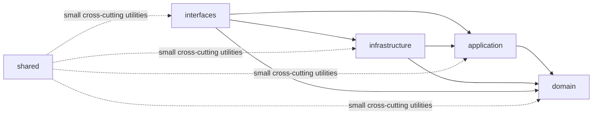

# Backend architecture

The Tauri backend stays in one Rust crate, `ix_print_lib`, and uses modules as
its architecture boundaries. Keep business rules independent of Tauri, HTTP,
PDFium, printer drivers, and file storage.

## Dependency direction

`application` owns the ports; `infrastructure` implements them. The
composition root in `lib.rs::run()` constructs those adapters and injects them
into `AppState`. `shared` is for small utilities without business rules.

| Layer | Owns | Must not depend on |
|---|---|---|
| `domain` | Business types, validation, and pure rules | Application, infrastructure, interfaces, Tauri/Actix, filesystem/process/network I/O, PDFium, or HTTP clients |
| `application` | Use cases, ports, and application state | Infrastructure, interfaces, Tauri/Actix, filesystem/process I/O, PDFium, or HTTP clients |
| `infrastructure` | Port implementations and external I/O | Interfaces or Tauri/Actix |
| `interfaces` | HTTP routes/handlers, Tauri commands, tray, and request/response mapping | Business rules beyond input extraction and response mapping |
| `shared` | Small cross-layer utilities, currently poison-tolerant locking | Business rules and framework-specific behavior |

`tests/architecture.rs` checks forbidden dependency tokens recursively in the
domain, application, and infrastructure source trees. It also limits Rust
source files under `src/` to 450 lines, except files named `tests.rs`.

## Module map

| Existing concern / source | Current location | Responsibility |
|---|---|---|
| `sync.rs` | `shared/sync.rs` | Poison-tolerant mutex locking |
| Settings, paper, margins, print options | `domain/settings/` | Print configuration types and validation |
| Template models, elements, records, pagination | `domain/template/` | Pure design model and record handling |
| Preset and import/export rules | `domain/preset.rs` | Preset validation and bundle decisions |
| Config model and server defaults | `domain/settings_config.rs` | Persistent configuration data and pure normalization |
| Auth token model and hashing | `domain/auth.rs` | Token generation, hashing, lookup, and extraction |
| Printer and printer-admin models | `domain/printer.rs`, `domain/printer_admin.rs` | Printer data, options, validation, and URI rules |
| Layout result and job models | `domain/layout.rs`, `domain/job.rs` | Pure print job and layout data |
| Remote model and routing rules | `domain/remote.rs` | Remote target resolution, URL/name rules, and hop marker |
| History, diagnostics, callback models | `domain/history.rs`, `domain/diagnostics.rs`, `domain/callback.rs` | Domain data and callback policy |
| Use cases and application state | `application/*_service.rs`, `application/state.rs` | Orchestration through ports; no concrete adapter dependencies |
| Port contracts | `application/ports.rs` | Repository, gateway, clock, callback, and server-control interfaces |
| Config, remote, history, diagnostics storage | `infrastructure/persistence/` | File-backed repositories and persistence details |
| PDF layout, rendering, preview, test page | `infrastructure/pdf/` | PDFium integration and generated documents |
| Printer discovery, printing, administration | `infrastructure/printing/` | CUPS and Windows printer adapters |
| Remote and callback HTTP clients | `infrastructure/net/` | Outbound requests through `ureq` |
| OS helpers | `infrastructure/os.rs` | Local address and operating-system integration |
| HTTP server and handlers | `interfaces/http/` | Routes, guards, DTOs, and HTTP response mapping |
| Tauri commands and tray | `interfaces/desktop/` | Desktop command registration, command adapters, and tray events |
| Application construction | `lib.rs::run()` | Build adapters, inject `AppState`, and start interfaces |

## Where new code belongs

- Put a business concept, invariant, or validation rule in `domain` when it
  needs no I/O or framework types.
- Put a user or system operation that coordinates domain rules in an
  `application` service. Define a port there when the operation needs an
  external capability.
- Put filesystem, PDFium, printer, network, and OS implementations in
  `infrastructure`; implement the application-owned port at that boundary.
- Put HTTP parsing/response mapping and Tauri command argument/result mapping
  in `interfaces`. Keep handlers thin: extract input, call a use case, map its
  result.
- Put code in `shared` only when it is a small utility used across layers and
  does not own business behavior.

When unsure, follow the dependency direction and avoid adding an abstraction
unless a real boundary or repeated behavior needs it.
